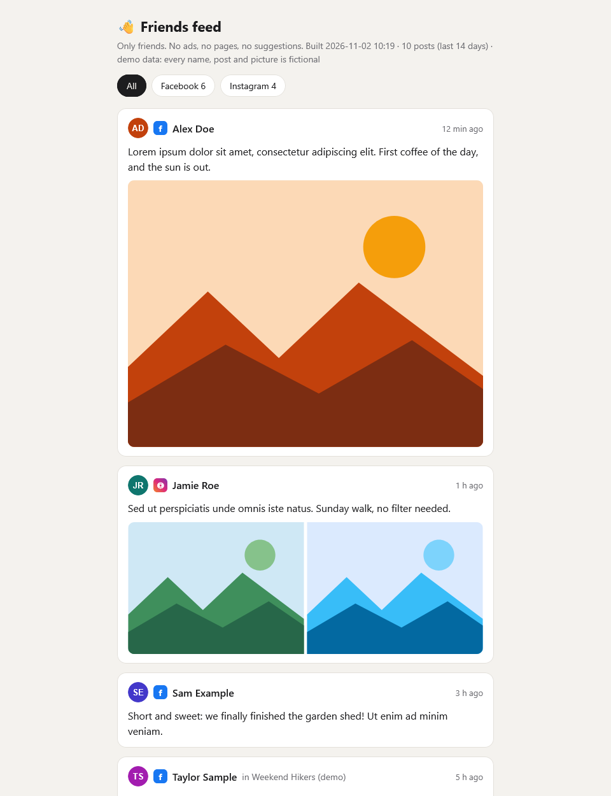

# 👋 onlyfriends

**Friends Only Social Media: your friends' posts, no ads, no suggestions.**

[🌐 Landing page](https://itstomekk.github.io/onlyfriends/) · [🚀 Try the demo](#-try-the-demo-in-3-commands) · [🔧 Use your own feed](#-use-it-with-your-own-account) · [🛠️ Development](DEVELOPMENT.md) · [📄 MIT license](LICENSE)

<p align="center">
  
</p>

> The screenshots show built-in **demo data**: every name, post and picture is made up.

## ✨ What it does

Facebook and Instagram bury the people you actually know under ads, pages and "suggested for you". onlyfriends opens your feed in your own browser session, **keeps only posts written by your friends**, and shows them on one calm page, newest first.

- 📥 Reads your Facebook **Friends** feed and your Instagram **Following** feed. Read-only: it never likes, comments, follows or posts.
- 🧹 A post stays only if the author is on your friends list (Facebook friends; Instagram mutual follows). Ads, pages, creators and suggestions are dropped.
- 🖼️ Saves post photos next to the page, because platform image links expire after a few days.
- 📰 One page, light and dark theme, filter by platform, **Refresh** button.
- 🔒 Runs on your computer only. The page listens on `127.0.0.1`. Nothing is uploaded anywhere.

## 🚀 Try the demo in 3 commands

No account, no install beyond Python 3.9+. The demo uses only made-up people.

```bash
git clone https://github.com/itstomekk/onlyfriends.git
cd onlyfriends
python serve.py --demo
```

Open <http://127.0.0.1:8766/>. That is the whole demo. (`--port 9000` if 8766 is taken.)

## 🔑 Use it with your own account

1. **Install the browser driver** once: `npm i -g agent-browser` and `agent-browser install`.
2. **Tell it who you are**: copy `config.example.json` to `config.json` and fill in your Facebook profile slug and Instagram username.
3. **Log in once** in a visible window, then close it. The session is kept in its own isolated profile:
   ```bash
   python ab.py facebook open https://www.facebook.com/ --headed
   python ab.py instagram open https://www.instagram.com/ --headed
   ```
4. **Collect your friends list** (slow on purpose, a big list takes a while): `python collect_fb.py friends`
5. **Refresh and read**: `python refresh.py`, then `python serve.py` and open <http://127.0.0.1:8766/>.

Instagram needs a friends list too: `python collect_ig_friends.py` builds it from accounts you follow that follow you back, and stops at the first rate-limit answer. Until it exists, Instagram is skipped.

Run `python refresh.py` from a scheduler (Task Scheduler, cron) if you want a morning refresh. Details are in [DEVELOPMENT.md](DEVELOPMENT.md).

## ⚠️ Plain-words limits

- **Unofficial.** Not affiliated with Meta, Facebook or Instagram. It reads the web pages the way you would, so it can **break whenever they change their layout**.
- **Read-only, with your own login.** It uses a browser session you log into yourself. It never asks for your password and never posts, likes or comments.
- **Check the platform terms.** Automated reading may go against Facebook's and Instagram's terms. Using it is your choice and your risk; keep the pace gentle (the defaults are slow and randomised) and do not point it at other people's accounts.
- **Local only.** There is no hosted version and there will not be one. Your session, friends list and saved posts stay in `data/` on your machine and are git-ignored.
- **Rough edges.** A Facebook run reaches roughly the last hour or so of posts if you have thousands of friends; run it often or press Refresh to fill gaps.

## 🤝 Contributing

Issues and pull requests are welcome, especially fixes for when a platform changes its markup. Please never attach real screenshots or data from your own feed. See [DEVELOPMENT.md](DEVELOPMENT.md).

## 📄 License

[MIT](LICENSE) © Tomek Kolodziejczuk
